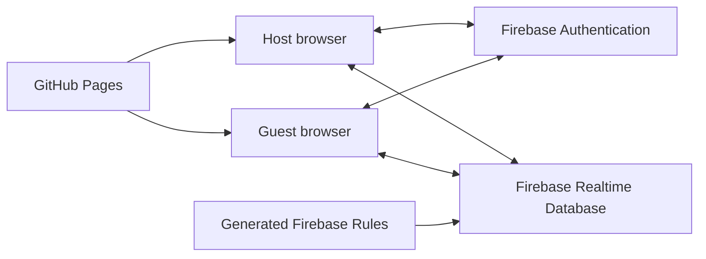

# Rival Roster user guide and technical reference

Rival Roster is a free, two-player browser game for building teams of wrestlers and comic characters. Players share a private room, play a draft or an auction, then compare and debate their teams. This guide covers the player experience, game rules, code, data, hosting, testing, and maintenance. [Play Rival Roster](https://aryanpande.github.io/rival-roster/)

## Contents

- [Player guide](#player-guide)
- [Game modes](#game-modes)
- [Settings and character pools](#settings-and-character-pools)
- [Results and discussion](#results-and-discussion)
- [Architecture and live updates](#architecture-and-live-updates)
- [Database and game state](#database-and-game-state)
- [Authorization and timing](#authorization-and-timing)
- [Character data and ratings](#character-data-and-ratings)
- [Source and file reference](#source-and-file-reference)
- [Deployment and maintenance](#deployment-and-maintenance)
- [Testing and troubleshooting](#testing-and-troubleshooting)

## Player guide

### Start and share a room

1. Open the game and select **Create Room**. Enter a display name of up to 28 characters. The home page also offers shortcuts for Blind Draft and Live Auction.
2. In the lobby, use **Copy link** or **WhatsApp** to send the room invite privately. The guest can also select **Join Room** on the home page and enter the six-digit code and their display name.
3. Watch the player cards for the guest to appear. The room has one host seat and one guest seat. Both players can inspect settings. The host chooses the settings and starts the match.
4. If you are hosting, select **Save settings** to share changes, then select **Start game** when both players are ready. If you select **Start game** while you have unpublished changes, the first click shares the settings and the next starts the match.
5. Use the center panel to play and the team panels to inspect rosters, slots, and auction balances. Expand **Match settings** to see the locked settings or expand the history panel to review play.

Use two devices, two browser profiles, or one regular window and one private window. Regular tabs in the same profile normally share a Firebase identity, so opening the invite in a second regular tab can return you to your original seat. Make sure both players keep the same browser profile throughout the match. [Room and lobby code](js/lobby.js)

### Rejoin, undo, reset, and rematch

| Control or event | What happens |
| --- | --- |
| Refresh or temporary disconnect | The game restores the latest room snapshot and the seat associated with your Firebase identity. Presence reflects the current connection sessions. |
| Leave room | The app stops watching the room and removes the current session from presence. The seat stays reserved. Keep the invite or code to return. |
| Lost browser storage or changed profile | Firebase assigns a new anonymous identity. A room with both seats occupied continues to recognize its original players. |
| Request undo | Either player can request an undo of the latest eligible gameplay move. The opponent can approve or decline. The requester can withdraw. |
| Reset match | The host can request a reset of an active match. The guest must approve. The room and its players stay in place. |
| Set up rematch | The host can start a new match after completion or an approved reset. The host can select a new mode or settings and swap team colors. The player seats and host permissions stay tied to the same identities. |

An outstanding undo or reset request pauses ordinary gameplay actions. Approval of an undo restores the state immediately before the targeted move, including rosters and money. If that restored phase has a timer, a new timer starts. A reset records the old match as reset, and the next match gets a new match number. [Gameplay transitions](js/engine.js)

### Browse characters and adjust sound

Open **Character Library** from the header to search by name, version, identity, publisher, alignment, or promotion. Use the universe and category filters, and select a card to see its ID, description, skills, and ratings. Cards in a match also open character details. The sound control toggles short gameplay tones and remembers your preference in the browser. The interface provides keyboard focus indicators, labelled controls, a skip link, and reduced-motion styling. [Views and accessibility](js/views.js) · [Styles](css/styles.css)

## Game modes

### Blind Draft

The host starts with a concealed sequence containing exactly enough cards for both teams. On your turn, choose **Recruit to my team** to receive the revealed card or **Assign to opponent** to give it away. Turn ownership alternates regardless of where the card goes. Once a roster is full, the game automatically assigns the remaining cards to the roster with space. With the optional timer enabled, an expired turn gives the revealed card to the turn owner if they have space, or to the other team. At the default size, ten unique eligible cards fill two five-card rosters. [Draft interface](js/draft.js) · [Draft rules](js/engine.js)

### Alternating Picks

Choose from the remaining cards in a visible pool. A pick always goes to the turn owner. Straight order alternates A, B, A, B. Snake order runs A, B, B, A, A, B, with the selected starting player taking the first slot. The optional timer selects the first unused pool card when a turn expires. The match ends when both teams are full. Extra pool cards remain unselected. [Draft interface](js/draft.js) · [Draft rules](js/engine.js)

### Live Auction

Each player gets the configured starting balance. The default is ₹100 in fictional credits. Each lot shows a character, the clock, the current bid, the leader, and your maximum available bid.

- Use the opening or increment button, the **Bid +₹5** shortcut, or **Custom bid**. The shortcut increases to the required minimum if the configured increment exceeds ₹5.
- A valid bid meets the opening price or raises the current bid by at least the configured increment. The current leader cannot raise their own bid. The game reserves enough money for every remaining roster slot.
- **Pass** ends your bidding for that lot. A player who was already leading keeps that bid and can still win. The lot closes when the clock expires or all players with an open slot have passed.
- A win adds the card to the winner's roster and deducts the final bid. An ordinary lot with zero bids is unsold and leaves the pool. A full team cannot bid.
- A late valid bid can extend the clock. The new deadline is the later of the current deadline and the accepted bid timestamp plus the configured anti-sniping window.
- In **Players nominate lots** mode, the eligible nominator chooses an unused card. On timeout, the game nominates the first unused card. The nomination clock uses the countdown setting. An auction clock starts when the nomination is accepted.
- If the number of unused lots equals the number of open team slots, reserve lots are assigned at the opening price. The game alternates the allocation priority and skips any full team.
- With automatic advancement, the result is shown briefly before the next lot. With **Advance lots manually**, select **Next lot**. The final sale takes you directly to the results.

The bid ceiling is your balance minus the opening price multiplied by the number of slots that would remain after this purchase. With ₹12, three open slots, and a ₹2 opening price, your cap is ₹8. [Auction interface](js/auction.js) · [Auction rules](js/engine.js)

## Settings and character pools

| Setting | Default and behavior |
| --- | --- |
| Game mode | Blind Draft. Alternating Picks and Live Auction are also available. |
| Characters per team | 5. The range is 1–8. |
| First player | Random. The host can select Host or Guest. |
| Character universe | Mixed. Wrestling only, Superheroes & villains, and Custom pool are available. |
| Draft order | Straight by default. Snake order applies to Alternating Picks. |
| Pick timer | Off. A timed draft accepts 5–120 seconds. |
| Auction starting budget | ₹100 per player. The range is ₹1–₹1,000, subject to enough credits to fill the team at the opening bid. |
| Auction opening bid and increment | ₹1 each. Each accepts ₹1–₹100. |
| Auction countdown and extension | 20 seconds and 5 seconds. The countdown accepts 5–120 seconds. The extension accepts 0–30 seconds and must fit within the countdown. |
| Auction nomination and advancement | Preselected randomized lot order and automatic advancement. Player nomination and manual advancement are optional. |
| Character versions | One version per identity. With duplicate identities allowed, different versions can appear together. Each exact card is still unique. |
| Team colors | Host red and guest blue at first. Rematch settings can swap colors. |

Expand **Character filters and versions** to choose wrestling promotions, comic publishers, and comic alignments. Selections within a category are alternatives. For comics, a publisher filter and an alignment filter both apply. In a mixed pool, wrestling promotion filters apply to wrestlers, while publisher and alignment filters apply to comic cards.

Enter comma-separated IDs in **Exclude character IDs** or **Custom pool character IDs**. A base identity in the exclude field removes all its versions. A version ID removes only that version. For a custom pool, the IDs refer to exact cards, including any specific version. Find these IDs in the character detail panel.

The pool needs at least twice the team size in eligible cards after identity filtering. Blind Draft uses exactly twice the team size. Alternating Picks can include six extra cards, and Live Auction can include eight, subject to eligible supply and a 24-card maximum. [Pool implementation](js/characters.js) · [Settings form](js/views.js)

## Results and discussion

The results page shows both rosters, each character version, auction balances and prices where applicable, a projected edge or draw, and category averages. It highlights each team's strongest and weakest categories and suggests strategies and matchups. Ratings reflect authored playstyle profiles and are intended for friendly comparisons.

In **Team debate**, each player can select a captain and preferred stipulation, enter preferred matchups and strategy notes, write an argument, mark readiness, vote, or mark the debate concluded. Select **Save discussion** to publish your entry to the other seat. **Balanced match** applies until both players save the same stipulation. The predicted edge and debate vote are independent. The conclusion message appears when both players mark the debate concluded. [Comparison code](js/comparison.js) · [Discussion form](js/views.js)

| Share action | What it produces |
| --- | --- |
| Copy teams | Player names and numbered rosters, including character versions. |
| Copy discussion prompt | Rosters, scores, category breakdown, and saved discussion material. Paste it where you want to continue the debate. |
| Share on WhatsApp | Opens WhatsApp with draft text containing the matchup and roster scores. You choose the recipient and send it. |
| Download JSON | A file with room and match identifiers, rules, players, complete roster card data, effective event history, discussion entries, and calculated comparison. |

If the browser blocks clipboard access, the app opens a text box from which you can copy manually. Share exported discussion text only with the people you want to read it. [Share and export handlers](js/app.js)

## Architecture and live updates

GitHub Pages serves one static application written in HTML, CSS, and JavaScript modules. GitHub Pages delivers the interface and card JSON. Firebase Authentication provides anonymous identity. Firebase Realtime Database stores rooms and accepts or denies writes according to generated rules. The browser loads Firebase's modular SDK on demand when connecting to an online room. Player invitations and result sharing use WhatsApp links.



1. `app.js` initializes the shell and fetches the public character catalogs. An invite or opening Multiplayer can restore a saved room. Solo drafts use static catalogs and local page state.
2. `firebase.js` initializes the SDK and restores or creates an anonymous Firebase Auth user. The host uses an atomic creation transaction to claim a new room code. The guest claims the write-once guest seat.
3. `lobby.js` listens to the room, connection status, and server time offset. Firebase presence uses one record per connection session and registers automatic removal on disconnect.
4. Starting a match writes the pool, configuration, and initial event together. The browser builds subsequent event candidates from the latest accepted snapshot and submits each candidate to the next event path in a transaction.
5. The rules validate the action and its full calculated snapshot. Firebase broadcasts accepted events. Each browser derives its roster and history by replaying the event log and renders the latest state.
6. A browser can request eligible automatic actions, such as timer settlement. Both seats can request the same next action, and the transaction permits only one accepted revision.

The current room code and sound preference are stored locally in the browser. Firebase Auth persists its own identity separately. During normal play, each room listener receives the room and its match history. The app selects the most recent match by numeric match number. [Application entry point](js/app.js) · [Firebase adapter](js/firebase.js) · [Room operations](js/lobby.js)

## Database and game state

```text
catalog/{cardId} = identityId
rooms/{sixDigitCode}/
  created
  p0/uid, p0/name
  p1/uid, p1/name
  proposal/
  presence/{uid}/{sessionId} = timestamp
  games/{matchNumber}/
    number, after, count
    config/
    pool/{index}/i, pool/{index}/id, pool/{index}/bit
    ids/{identityOrCardId} = index
    events/{seq}/
      seq, kind, actor, at, card, amount, recipient
      s/
    discussion/{uid}/
      seq, captain, stipulation, matchups, strategy, argument
      ready, vote, concluded
```

| Record | Meaning |
| --- | --- |
| `catalog` | Card ID to identity ID allowlist for pool validation. Detailed ratings, descriptions, and images are served as static assets. |
| `p0` and `p1` | Host and guest profiles. UID is authoritative for membership. The display name is used in the UI. |
| `proposal` and `config` | The editable next-match settings and the immutable settings snapshot for a particular match. |
| `number`, `after`, `count` | Match number, last revision of the preceding match, and pool size. Match 0 uses `after = -1`. |
| `pool` and `ids` | The indexed pool and its reverse uniqueness mapping. A card's `bit` is 2 raised to its index. |
| `events` | Append-only revisions starting at 0. Each event holds the move, actor, timestamp, inputs, and full resulting state. |
| `discussion` | Each member can edit their own discussion entry on the latest completed match revision. |

The state snapshot `s` stores `phase`, roster counts `n0` and `n1`, balances `m0` and `m1`, `round`, `turn`, current pool `index`, the `used` mask, `leader`, `bid`, `passed`, `deadline`, and the event's `award`, `card`, and `price`. `round` counts assigned cards in a draft and settled lots in an auction, including unsold lots. `used` records drafted cards and settled auction lots. The pass mask uses 1 for the host, 2 for the guest, and 3 for both. Event-level `card` is a requested card index. State-level `card` identifies the card involved in the resulting award or settlement.

Draft matches flow from `draft` to `done`. Auction matches cycle through optional `nominate`, `auction`, and `settled` phases until the final lot enters `done`. Agreement to reset moves an active match to `reset`. Undo appends a compensating event and removes the prior effective move from the history projection. The underlying accepted revisions remain in Firebase. [State machine](js/engine.js) · [Generated rules](firebase/database.rules.json)

### Event reference

| Event | Accepted action and effect |
| --- | --- |
| `start` | Host creates revision 0 with an approved pool, saved configuration, and starting seat. |
| `assign`, `autoAssign` | Award the revealed card to the requested or automatically selected seat. |
| `pick`, `autoPick` | Assign a visible unused card to the turn owner. On timeout, choose the lowest unused pool index. |
| `nominate`, `autoNominate` | Open an auction for a selected unused card. On timeout, choose the lowest unused pool index. |
| `bid`, `pass` | Update the leading bid and deadline, or set the actor's pass bit. |
| `close`, `reserve` | Settle an ordinary lot after expiry or passes, or allocate a reserve lot at the opening price. Update roster and balance when awarded. |
| `advance` | Open the next nomination or auction after settlement. Automatic advancement waits about two seconds. |
| `askUndo`, `askReset` | Record a consent request and pause play. Reset requests come from the host. |
| `decline`, `withdraw` | Resolve a consent request without applying it. The opponent may decline, and the requester may withdraw. |
| `undo`, `reset` | Apply the opponent's approval, restoring the prior state or ending the active match. |

Database validation caps match numbers at 1000 and event revision numbers at 4000. Discussion saves apply to the current completed revision and are limited to 240 characters for matchups, 500 for strategy, and 600 for the argument. The stored timestamp and seat are independent of labels shown in the UI. [Event transitions](js/engine.js) · [Validation limits](tools/rules.mjs)

## Authorization and timing

- Firebase denies root reads and writes by default. Signed-in users may read the catalog. Existing room snapshots are available only to the two assigned UIDs. Client writes to the catalog are denied.
- An anonymous UID can create an unused six-digit room. An authenticated non-host can claim an empty guest seat. A code can be guessed before the guest seat is claimed, so share it directly with your opponent. After both seats are assigned, the code alone gives another UID no access to the room.
- The host can change the proposal. Match creation requires a guest, a valid initial state, eligible catalog IDs, a consistent pool and identity mapping, and a configuration matching the saved proposal. A later match requires the immediately preceding match to have ended or been reset.
- Event rules authenticate `actor`, require a valid predecessor and an unused sequence key, validate move inputs, and recalculate every state field from accepted state. Events on previous matches can no longer be appended once the next match starts.
- The engine defines predicates and resulting fields once. The browser evaluates them in JavaScript, and `tools/rules.mjs` emits equivalent Firebase Rules. Server-side validation is the final decision on a write.
- Firebase's `now` checks whether a turn or lot is open. An event timestamp must be within 2 seconds behind or 1 second ahead of the database clock. The accepted timestamp anchors subsequent deadlines. If both browsers disconnect at expiry, settlement resumes when a player reconnects. The browser uses `.info/serverTimeOffset` for an approximate countdown.
- The host browser generates the pool and random first player with Web Crypto. Firebase verifies catalog membership, sizes, and uniqueness. A modified host client can choose the pool order or bypass lobby filters, and a player inspecting traffic can see future cards. Blind Draft conceals those cards in the standard interface.
- Rooms and match histories persist until an administrator removes them. Consider retention when running the project long-term, since the room listener loads the room's history and the Spark plan has service quotas.

The rules enforce the gameplay transitions and participant permissions above. Comparison scores are calculated on the client from the published ratings and carry no effect on drafting, bidding, or credits. [Rules generator](tools/rules.mjs) · [Match engine](js/engine.js)

## Character data and ratings

The active catalog contains **275 playable cards** covering **154 wrestling identities** and **118 comic identities**, with **three comic alternate versions**. `tools/wrestlers.json` stores the approved wrestler records and `tools/comics.txt` authors comic cards. The generator emits static data and Firebase identity mappings, with 29 retired wrestling cards preserved for historical matches.

| Data | Fields used by the app |
| --- | --- |
| All cards | Stable `id`, base `identity`, name, universe, version, description, and ratings. |
| Wrestling cards | Promotions, era, wrestling style, optional weight class, signature moves, and finisher. |
| Comic cards | Publisher, alignment, and abilities. |
| Variant handling | Alternate card IDs share the base identity and may apply a rating modifier. |
| Presentation | Styled initials identify cards. The welcome screen uses generic arena artwork. |

### How scores are calculated

1. Compute each team's mean rating in every applicable category. Wrestling uses Technical wrestling, Strength, Speed, Endurance, Hardcore experience, Promo ability, and Star power. Comics uses Strength, Speed, Intelligence, Combat skill, Durability, Powers, and Teamwork.
2. In a mixed match, keep Strength and Speed. Map Technique to wrestling technical ability or comic combat skill, Resilience to endurance or durability, Coordination to promo or teamwork, and Specialty to hardcore experience or powers.
3. Multiply each category mean by its stipulation weight, add the results, and divide by the sum of weights. The default weight is 1. Only listed keys present in the match apply.
4. The higher weighted mean receives the projected edge. A difference less than 0.05 is shown as a draw. The UI displays scores to one decimal place.
5. Strengths and weaknesses are the highest and lowest team category averages. The strategy text uses the largest head-to-head category advantage. Suggested matchups sort both teams by the unweighted sum of their active ratings and pair the cards by rank.

| Stipulation | Categories with extra weight |
| --- | --- |
| Balanced match | All categories use weight 1. |
| Survivor Series elimination | Endurance, Teamwork, Resilience ×2 |
| Texas Death Match | Endurance and Resilience ×2. Hardcore experience and Specialty ×3. |
| WarGames | Hardcore experience, Strength, Specialty ×2 |
| Traditional tag team | Technical wrestling, Teamwork, Technique, Coordination ×2 |
| No-disqualification | Hardcore experience, Specialty ×3 |
| Ladder match | Speed ×3. Endurance and Resilience ×2. |
| Open battlefield | Strength, Powers, Specialty ×2 |
| Urban combat | Speed, Combat skill, Technique ×2 |
| Preparation time allowed | Intelligence ×3. Technical wrestling and Technique ×2. |
| Defend the target | Durability, Teamwork, Resilience, Coordination ×2 |
| Last team standing | Durability, Endurance, Resilience ×3 |
| No preparation time | Speed, Combat skill, Technique ×2 |

The wrestling source stores approved ratings directly. Comic ratings use authored style profiles and small deterministic variations from card IDs. Those numbers are game inputs. [Rating generation](tools/catalog.mjs) · [Comparison calculations and weights](js/comparison.js)

## Source and file reference

| Path | Responsibility |
| --- | --- |
| `index.html` | Static shell, metadata, navigation, status message, and dialog container. |
| `css/styles.css` | Responsive layout, game panels, visual feedback, focus, and reduced-motion preferences. |
| `assets/arena.webp`, `assets/favicon.svg` | Home artwork and browser tab icon. |
| `js/app.js` | Page updates, form and click handling, room recovery, timing display, effects, sharing, and exports. |
| `js/views.js`, `js/icons.js` | UI templates, HTML escaping, and inline interface icons. |
| `js/draft.js`, `js/auction.js` | Mode-specific screens and eligible automatic moves. |
| `js/engine.js` | Defaults, legal event predicates, state transitions, undo, and roster projection. |
| `js/firebase.js`, `js/config.js` | SDK loading, emulator wiring, anonymous authentication, and public Firebase web settings. |
| `js/lobby.js` | Room creation and joining, subscriptions, presence, proposal writes, transactions, and discussion writes. |
| `js/characters.js`, `js/comparison.js` | Search, filter, pool selection, identity handling, scores, and discussion prompt generation. |
| `data/wrestlers.json`, `data/superheroes.json` | Generated public catalogs with detailed character records. |
| `firebase/database.rules.json` | Generated Realtime Database authorization and validation rules. |
| `firebase/seed.json`, `firebase/catalog.seed.json` | Root import for an empty database and catalog-only import for an existing database, respectively. |
| `tools/catalog.mjs`, `tools/wrestlers.json`, `tools/comics.txt` | Catalog generator and authored character inputs. |
| `tools/rules.mjs` | Compiles the shared game transitions and security rules into Firebase rules JSON. |
| `tools/seed-emulator.mjs`, `tools/preview.mjs` | Seeds local Firebase data and serves a static development preview, respectively. |
| `firebase.json` | Rules file path and configuration for local Auth, Database, and Hosting emulators. |
| `tests/core.test.mjs`, `tests/firebase.test.mjs` | Unit and Firebase emulator integration tests. |
| `package.json`, `package-lock.json` | Development scripts and reproducible dependencies. |
| `.github/workflows/deploy.yml` | Runs core tests, stages the static artifact, and deploys it to GitHub Pages. |
| `.gitignore`, `LICENSE` | Local build and debug exclusions, and MIT license for the project code. |
| `README.md`, `SETUP.md`, `DOCUMENTATION.md` | Project overview, setup checklist, and complete guide. |

## Deployment and maintenance

### Services and first-time setup

The live site uses GitHub Pages for hosting and the Firebase Spark project for Auth and Realtime Database. The deployment workflow runs on pushes to `main` and can also be run manually from **Actions**. It runs the core tests, then publishes `index.html`, `assets/`, `css/`, `js/`, and `data/`. Rules and catalog imports are administered separately in Firebase. Node and Java are development tools. Players need an HTTPS browser and an internet connection.

For a fresh deployment, create a Firebase Spark project, add a web app, enable Anonymous sign-in, and create Realtime Database in Locked mode. Publish `firebase/database.rules.json`, then import `firebase/seed.json` into the root of the empty database. Add the actual database URL and public web app settings to `js/config.js`. Add the Pages hostname to **Authentication → Settings → Authorized domains**, without a path. In GitHub **Settings → Pages**, select **GitHub Actions**. Run the deploy workflow and check the published URL with two separate browser identities. [Detailed Firebase and Pages setup](SETUP.md)

The Firebase client config is intended for the public website. Keep admin credentials, service-account keys, and account tokens out of Git and the website. Firebase Rules and authenticated UIDs control access. If you want the same anonymous account to keep its room seats beyond 30 days, leave Firebase's anonymous-account auto clean-up off where the option is available.

### Change a feature or update data

| Change | Steps |
| --- | --- |
| UI text, styling, or accessibility | Edit the applicable source, run `npm test`, and verify on the deployed site after Pages completes. |
| Add or revise character cards | Update the authored catalog, run `npm run generate` and `npm test`, and review the active cards, archive and identity mapping. Verify production catalog compatibility before deploying the static catalog. Apply any explicitly approved missing entries at `catalog` while preserving existing mappings. |
| Change game rules | Update `js/engine.js` and, for schema or authorization changes, `tools/rules.mjs`. Run generation, core tests, and emulator tests. Coordinate the Firebase rules publication and site release for validator changes. |
| Change Firebase project | Follow the first-time setup for the new database and update `js/config.js` before publishing the new site artifact. Existing room data and anonymous identities belong to the original project. |

Use the root `firebase/seed.json` import only for an empty database. Importing it into a populated root can overwrite rooms. Back up any live data you need before a Firebase data change. For recovery from a release issue, restore or revert the source to the last known good version and redeploy. If rules changed as part of that release, publish the corresponding rules version separately. [Rules and seeds](firebase/) · [Deployment workflow](.github/workflows/deploy.yml)

## Testing and troubleshooting

### Local development

Use Node.js 22 or later and Java 21 for the emulator. Install dependencies with `npm ci`. Use `npm run generate` after changing catalog sources or the rules definitions.

```bash
npm ci
npm test
npm run test:emulator
```

For local interactive testing, run `npm run preview`. In a separate terminal, run `npm run seed:emulator`. Open `http://127.0.0.1:5000/?emulator=1`. To simulate a distinct guest in another tab of that browser, add `&guest=1` to the copied invite. The Authentication emulator uses port 9099, the Realtime Database emulator uses 9000, and the Hosting emulator uses 5000. The emulator suite clears its demo database, so use a separate interactive run from the automated suite. `npm run dev` starts the static preview server, while `npm run preview` starts the complete local stack. [Package scripts](package.json) · [Emulator configuration](firebase.json)

| Check | Coverage |
| --- | --- |
| `npm test` | Unit coverage includes solo flows, catalog generation, draft order, timer fallbacks, card uniqueness, auction bids and budgets, reserve lots, nominations, consent, catalog validation, and deterministic scores. |
| `npm run test:emulator` | Two integration scenarios covering private access, guest-seat ownership, concurrent writes, reconnect, locked settings, discussion permissions, rematches, lot timing, stale bids, and settlement. |
| Two-tab browser check | Create and join a room, complete a default-size draft, refresh the guest, start an auction rematch, and confirm synchronized bids, rosters, and deductions. |
| Production deployment check | Confirm the Pages run and assets, anonymous sign-in and all 304 expected catalog mappings, then complete a two-player draft with matching results on live Firebase. |

After changes, check the welcome page and library, host and guest lobby views, save-and-start behavior, draft and auction actions, refresh recovery, history, debate save, copy, and download. Use narrow and wide viewport widths. After a rules or timing change, verify first-valid-write behavior and test before and after a deadline. [Core tests](tests/core.test.mjs) · [Firebase tests](tests/firebase.test.mjs)

### Common problems

| Symptom | What to check |
| --- | --- |
| The guest sees the host's seat | Open the invite in a different browser profile, private window, or device. |
| Room code is full or unavailable | Check the digits and the browser profile. Both occupied seats remain tied to their original identities. Create a fresh room for a different guest. |
| Firebase sign-in fails | Confirm the Anonymous provider is enabled, the public config matches the project, and the Pages origin is allowed. |
| The host can make a room but starting fails | Check that the guest has joined, enough eligible cards remain, the settings were saved, and Firebase has the current rules and catalog mapping. |
| A bid or click was rejected | Check the latest turn, timer, balance, pass status, and active lot. If both players submitted at once, the first accepted revision takes precedence. |
| The lot stayed on screen after time ran out | Wait for a browser to reconnect. If a consent request is open, resolve it. If manual advancement is on and the lot is already settled, select **Next lot**. |
| A stipulation hasn't changed the scores | Both players must save the same stipulation. Until they agree, the comparison stays balanced. |
| GitHub Pages reports a failed build or returns 404 | Check **Settings → Pages → GitHub Actions** and the latest workflow run. Read the failing step and confirm the production URL in Pages settings. |
| Catalog import fails or shows an empty database | Verify the file is saved as JSON and that its shape matches the target. A root seed has a `catalog` wrapper. A catalog-only seed contains the ID mapping directly. |
| Players have different character details after an update | Verify both browsers loaded the latest deployment and that old card IDs remain available. Reload the site after updating the static catalog. |

[Project README](README.md) · [Setup checklist](SETUP.md) · [GitHub Actions runs](https://github.com/AryanPande/rival-roster/actions)
